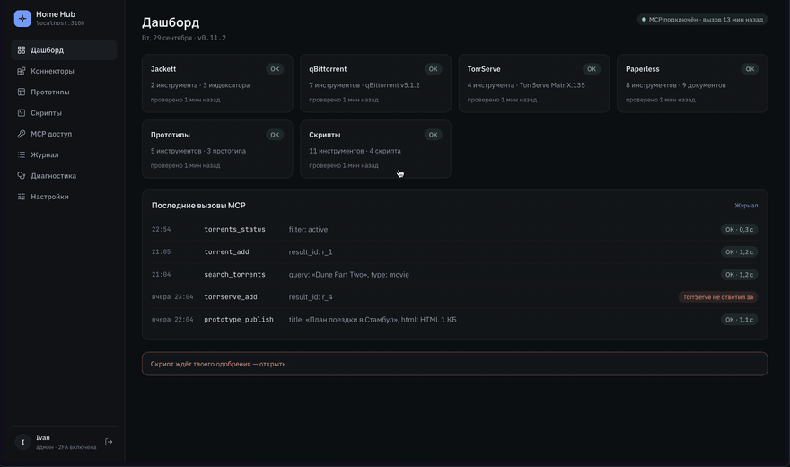

<p align="center">
  
</p>

<h1 align="center">Home MCP Hub</h1>

<p align="center">
  A self-hosted MCP hub that connects your home services to Claude and ChatGPT.
</p>

<p align="center">
  <a href="https://github.com/Ivan-Kuzmichev/home-mcp-hub/releases/latest"></a>
  <a href="https://github.com/Ivan-Kuzmichev/home-mcp-hub/actions/workflows/docker.yml"></a>
  
  <a href="LICENSE"></a>
</p>

<p align="center">
  <b>English</b> · <a href="README.ru.md">Русский</a>
</p>

One Docker container with an admin panel. Your assistant searches and downloads torrents, starts streaming,
sorts your documents, publishes HTML prototypes and runs your scripts.



## Features

- **Connectors:** Jackett, qBittorrent, Transmission, TorrServe, Paperless-ngx, folders on disk (read, edit and move, by access level), the camofox browser and mitmproxy traffic capture. Set them up in the admin panel and turn off the tools you don't need.
- **camofox:** the assistant opens sites in the [camofox](https://github.com/jo-inc/camofox-browser) stealth browser from your home IP.
  It reads pages, links and YouTube subtitles and takes screenshots. Read-only by default; clicks, typing and navigation are behind a switch.
  For example: "open news.ycombinator.com and sum up the top five headlines", "what does this video say: <YouTube link>".
- **mitmproxy:** the assistant sees where the apps on your home devices go, and behind a switch replaces service responses
  (the `hub_mocks.py` addon; rules are data, never code). For example: "where did the Bank app go in the last 10 minutes",
  "replace the api.example.com/v1/profile response: isPremium = true", "turn the mock off".
- **Prototypes:** the assistant publishes an HTML page and gives you a link, optionally with a PIN, an expiry date and a small JSON database.
- **Scripts:** cron jobs and your own MCP tools in JavaScript, run in a sandbox, with secrets that neither the script nor the model can see.
- **Security:** OAuth 2.1 with PKCE and mandatory 2FA, a secret path prefix, encrypted service passwords, files that are always closed (keys, `.env`, VPN configs) and a log of every call.
- **Instructions for the assistant:** each connector has its own text, which you can extend or replace. The Diagnostics screen shows what the model receives.

The admin panel and the tool replies are in Russian.

## Install

`docker-compose.yml`:

```yaml
services:
  hub:
    image: ghcr.io/ivan-kuzmichev/home-mcp-hub:latest   # or pin a version: :0.15
    restart: unless-stopped
    env_file: .env
    environment:
      DATABASE_PATH: /data/hub.db
      TZ: Europe/Moscow
    ports:
      - '3000:3000'
    volumes:
      - ./data:/data
```

`.env` next to it (`chmod 600 .env`):

```bash
BASE_URL=https://hub.example.com        # public address without the prefix; MCP works over https only
HUB_MASTER_KEY=                         # openssl rand -hex 32, encrypts service passwords
BETTER_AUTH_SECRET=                     # openssl rand -base64 32
ADMIN_EMAIL=you@example.com
ADMIN_PASSWORD=                         # 12+ characters, needed on the first start only
TRUST_PROXY=1                           # the hub sits behind a reverse proxy (Traefik, Caddy, Pangolin…)
```

```sh
docker compose up -d
docker compose logs hub | grep "Admin panel"   # the admin address with the secret prefix, printed once
```

Then:

1. Open the address from the log, sign in and set up 2FA. The admin panel stays closed without it.
2. **Коннекторы** (Connectors): enter the service addresses, for example `http://qbittorrent:8080` if the hub shares a Docker network with them.
3. **MCP доступ** (MCP access): copy the MCP URL and turn on client registration.
   - **Claude:** Settings → Connectors → Add custom connector → the URL, leave the OAuth fields empty → Connect.
   - **ChatGPT:** Apps → Add → Create MCP app → the URL, OAuth authentication → Create.
4. Sign in, enter the 2FA code and press **Разрешить** (Allow). In a new chat, ask it to `call hub_status`.

## Update

```sh
docker compose pull && docker compose up -d
```

Database migrations run on start. All state lives in `./data`; backups and the rest are in [docs/deployment.md](docs/deployment.md).

## Documentation

In Russian:

- [Deployment](docs/deployment.md): reverse proxy, host network, images and versions, auto-update, backups
- [Connectors and tools](docs/connectors.md): what each connector does, instructions, Paperless, scripts and custom tools
- [Security](docs/security.md): how sign-in, OAuth, the prefix, secrets and prototypes are protected
- [Development](docs/development.md): running locally, checks, releases

## Releases

A `v*` tag builds the `ghcr.io/ivan-kuzmichev/home-mcp-hub` image tagged `X.Y.Z` and `X.Y` and publishes a GitHub Release
with the commits since the previous tag. Every push to `main` updates `latest`.

## License

[MIT](LICENSE)
